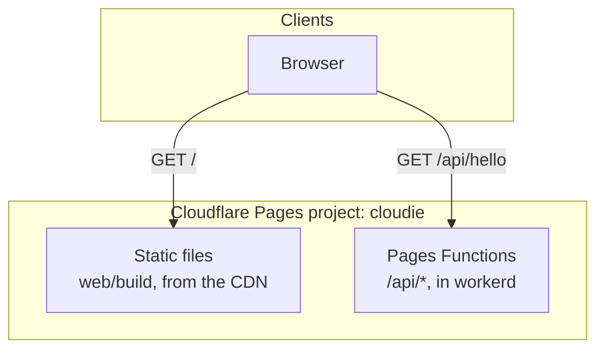

# Architecture and resources

What runs where, who reaches it, and which file defines it.

## The pieces

A visitor's browser gets the prerendered page straight from Cloudflare's CDN, then the page calls `/api/hello`,
which runs a Function in the data center nearest to them.

| Resource        | What it is                                                                                                                                                                                              | Reached by                 | Defined in                                                                        |
| --------------- | ------------------------------------------------------------------------------------------------------------------------------------------------------------------------------------------------------- | -------------------------- | --------------------------------------------------------------------------------- |
| Pages project   | One Cloudflare Pages project serving the static site and the Functions under one address (`cloudie.pages.dev`)                                                                                          | Everyone                   | `backend/infra/main.tf` (the project), `backend/api/wrangler.toml` (its settings) |
| Static site     | HTML, CSS and JS that SvelteKit prerenders at build time. Cached at the edge; no server runs for it                                                                                                     | Browsers                   | `web/`                                                                            |
| Pages Functions | TypeScript files in `backend/api/functions/`; the file path is the route (`api/hello.ts` → `/api/hello`)                                                                                                | Browsers                   | `backend/api/functions/`                                                          |
| Middleware      | `_middleware.ts` runs before every Function: common headers, errors as JSON                                                                                                                             | Every `/api` request       | `backend/api/functions/_middleware.ts`                                            |
| Agent Worker    | A separate Worker (`cloudie-agent`) hosting the `SalesAgent` Durable Object of the Cloudflare Agents SDK; routed under `/agents/*`. One Durable Object per chat, deleted 30 days after its last message | Browsers                   | `backend/agent/`                                                                  |
| CONFIG KV       | A KV namespace holding the assistant's runtime config under key `config` (read by the agent Worker, cached 60 s)                                                                                        | Agent Worker               | `backend/agent/wrangler.toml`, `backend/agent/src/config.ts`                      |
| RATE_LIMIT      | A Workers rate-limit binding on the agent Worker: 20 chat messages per minute per client IP (`cf-connecting-ip`); over the limit the agent replies with a slow-down message                             | Agent Worker               | `backend/agent/wrangler.toml`, `backend/agent/src/agent.ts`                       |
| Custom domains  | Optional. A `cloudflare_pages_domain` plus a proxied CNAME per domain                                                                                                                                   | Everyone                   | `backend/infra/variables.tf` (`custom_domains`)                                   |
| Terraform state | A private R2 bucket holding Terraform's record of what it manages                                                                                                                                       | `./cli.sh infra-*`         | `backend/infra/backend.tf`, created by `./cli.sh infra-bootstrap`                 |
| API tokens      | Admin (Terraform), state (R2 key pair), deploy (Wrangler, CI)                                                                                                                                           | `./cli.sh`, GitHub Actions | `scripts/tokens.sh`                                                               |

## Glossary

| Term             | Meaning                                                                                                          |
| ---------------- | ---------------------------------------------------------------------------------------------------------------- |
| Cloudflare Pages | Cloudflare's hosting for static sites plus Functions, deployed together with `wrangler pages deploy`             |
| Pages Function   | A request handler (`onRequestGet`, `onRequestPost`, …) that runs on Cloudflare's Workers runtime                 |
| workerd          | The open-source Workers runtime. Wrangler and the tests run it locally, so local behaviour matches production    |
| Binding          | A named handle on `env` that gives a Function a resource (a D1 database, an R2 bucket, a KV namespace, a secret) |
| Wrangler         | Cloudflare's CLI: local dev server, deploys, secrets, database migrations                                        |
| Prerender        | Rendering a page to HTML at build time instead of per request                                                    |
| Terraform state  | Terraform's record of the real resources it created, so it can tell what changed                                 |

## Who does what

| Tool      | Owns                                                                                      |
| --------- | ----------------------------------------------------------------------------------------- |
| Terraform | The containers: Pages project, domains, DNS. Later databases, buckets, Access apps        |
| Wrangler  | The contents: code deploys, secrets, bindings (from `wrangler.toml`), database migrations |

Terraform ignores the Pages project's deployment settings (`ignore_changes`), so `wrangler.toml` stays the one
place bindings are declared and secret values never reach the Terraform state. More in the
[infrastructure README](reference/infra).

## Shared types

`shared/protocol` defines every API reply once, as a Zod schema. The Function builds a value of that type, the
website parses the reply with the same schema, and tests check both ends. It uses `zod/mini`, Zod's tree-shakable
build, so the website only ships the validators it calls (about 5 KB gzipped for the hello page).

## Why these choices

| Choice                                               | Why                                                                                                       |
| ---------------------------------------------------- | --------------------------------------------------------------------------------------------------------- |
| Pages (static + Functions)                           | One deploy, one address, no CORS between site and API, free tier generous for small projects              |
| SvelteKit prerendered                                | Pages are plain HTML on the CDN: fast first paint, nothing to run per page view. Svelte 5 ships little JS |
| Functions in `backend/`, not SvelteKit server routes | The API stays testable in workerd, independent of the website                                             |
| Terraform for infra                                  | New account or new environment in one command; changes reviewed as a plan first                           |
