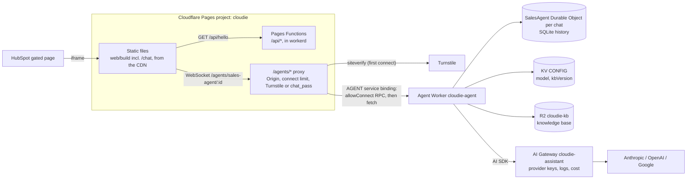
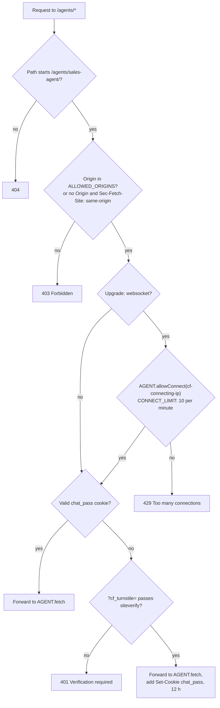
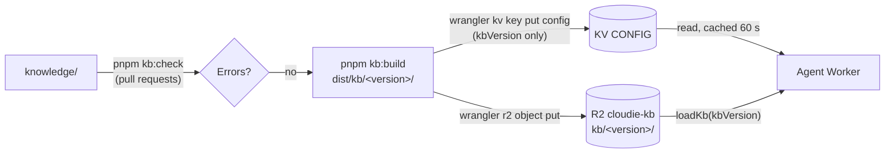

# Architecture and resources

What runs where, who reaches it, and which file defines it.

## The pieces

A visitor's browser gets the prerendered page straight from Cloudflare's CDN, then the page calls `/api/hello`,
which runs a Function in the data center nearest to them. Running the assistant (model, keys, knowledge base,
HubSpot, costs) is in [The sales assistant](../guide/assistant.md).

The chat page is embedded as an iframe in a gated HubSpot page, but its own URL is public, and so is the
assistant: see [Who can use the chat](#who-can-use-the-chat). The agent Worker itself is only reachable through
this proxy:

Every request under the path goes through these checks: the WebSocket upgrade and the Agents SDK's HTTP GET and
POST calls alike, except that only WebSocket upgrades count against the connect limit (the page's
`get-messages` GET on every load would otherwise lock out an office sharing one NAT address). The `cf_turnstile` token is removed from the URL and the `Cookie` header is dropped before the
request reaches the agent; the rest of the request, including `cf-connecting-ip` (which Cloudflare sets itself,
so clients cannot choose it), is forwarded unchanged so the agent's per-IP message limit works.

How the chat page connects:

| Step    | What happens                                                                                                                                                                                                                                                                                                                                              |
| ------- | --------------------------------------------------------------------------------------------------------------------------------------------------------------------------------------------------------------------------------------------------------------------------------------------------------------------------------------------------------- |
| Chat id | `crypto.randomUUID()` kept in `sessionStorage` (`chat-session`): one conversation per tab; a reload keeps it, "New chat" clears it                                                                                                                                                                                                                        |
| Connect | Agents SDK `AgentClient` (a reconnecting WebSocket) with the SDK's `WebSocketChatTransport` under the AI SDK's Svelte `Chat`. Every connect attempt, reconnects included, runs a fresh Turnstile check. Reconnecting stops after 8 attempts (then the page shows a Reconnect button) and pauses while the tab is hidden (`web/src/lib/chat/reconnect.ts`) |
| State   | The agent pushes `AgentState` (`kbVersion`, `allowlist`) on connect; the page renders links against that allowlist                                                                                                                                                                                                                                        |
| History | After the first successful connect the page GETs `/agents/sales-agent/<id>/get-messages` with the `chat_pass` cookie only (no token). Without the cookie (Safari) it gets 401 and starts empty                                                                                                                                                            |

### Who can use the chat

Anyone with a browser who has the chat page's URL can use the assistant. None of the checks above identifies a
HubSpot user:

| Check             | What it really does                                                                                                                       |
| ----------------- | ----------------------------------------------------------------------------------------------------------------------------------------- |
| Origin            | Must be the chat page's own origin. Opening `/chat` directly sends exactly that, so it only stops other websites from scripting the agent |
| `frame-ancestors` | Limits which pages may frame `/chat`; it does nothing when `/chat` is opened directly                                                     |
| Turnstile         | Stops bots and scripts, not people: any human passes it                                                                                   |
| `chat_pass`       | A 12-hour bearer pass: whoever holds the cookie value can connect without Turnstile until it expires                                      |
| Rate limits       | 10 WebSocket connects and 20 messages per minute per IP, plus the AI Gateway's 300 requests per 60 s: they cap cost, not who can ask      |

So the real gate is Turnstile plus the rate limits, and everything in the uploaded knowledge base (every
document in `prompt.md`, drafts included after stripping) can be extracted by such a person by asking for it.
`GET /api/health` is public too and reports the live `model` and `kbVersion`.

**Decision for the owner:** to limit the chat to signed-in staff, put
[Cloudflare Access](https://developers.cloudflare.com/cloudflare-one/policies/access/) in front of `/chat` and
`/agents/*` (an identity login; test it inside the HubSpot iframe, where browsers may block its cookie), or have
the HubSpot page pass a short-lived token signed with a shared secret that the proxy checks before Turnstile.
Neither is built. Separately, `frame-ancestors` should be narrowed to the real HubSpot page origin
(**TODO(user)** in `web/static/_headers`, see [Embed in HubSpot](../guide/assistant.md#embed-in-hubspot)).

The page's script policy is a `<meta>` Content-Security-Policy that SvelteKit writes at build time (`csp` in
`web/vite.config.ts`, with the hash of its inline start-up script); `frame-ancestors`, `frame-src`, `connect-src`,
`img-src` and `form-action` are response headers from `web/static/_headers`, because a `<meta>` policy cannot set `frame-ancestors`.

| Resource         | What it is                                                                                                                                                                                                                                                                                                                                                                                                                                                                                                                                                                                | Reached by                 | Defined in                                                                         |
| ---------------- | ----------------------------------------------------------------------------------------------------------------------------------------------------------------------------------------------------------------------------------------------------------------------------------------------------------------------------------------------------------------------------------------------------------------------------------------------------------------------------------------------------------------------------------------------------------------------------------------- | -------------------------- | ---------------------------------------------------------------------------------- |
| Pages project    | One Cloudflare Pages project serving the static site and the Functions under one address (`cloudie.pages.dev`)                                                                                                                                                                                                                                                                                                                                                                                                                                                                            | Everyone                   | `backend/infra/main.tf` (the project), `backend/api/wrangler.toml` (its settings)  |
| Static site      | HTML, CSS and JS that SvelteKit prerenders at build time. Cached at the edge; no server runs for it                                                                                                                                                                                                                                                                                                                                                                                                                                                                                       | Browsers                   | `web/`                                                                             |
| Chat page        | `/chat`, prerendered like every page. Runs a Turnstile check (sitekey `PUBLIC_TURNSTILE_SITEKEY`, declared in `web/src/env.ts` and inlined at build time; outside production builds it defaults to Turnstile's always-pass test key, and a production build fails without it), then opens the agent WebSocket with `?cf_turnstile=<token>` and renders replies as sanitised markdown (a markdown-only tag list: no images, forms or style attributes). Links not on the agent's allowlist (its state) become plain text. HubSpot may frame it: `frame-ancestors` in `web/static/_headers` | Browsers (HubSpot iframe)  | `web/src/routes/chat/`, `web/src/lib/chat/`                                        |
| Pages Functions  | TypeScript files in `backend/api/functions/`; the file path is the route (`api/hello.ts` → `/api/hello`)                                                                                                                                                                                                                                                                                                                                                                                                                                                                                  | Browsers                   | `backend/api/functions/`                                                           |
| Middleware       | `_middleware.ts` runs before every Function: common headers, errors as JSON. WebSocket upgrades (101) pass through untouched                                                                                                                                                                                                                                                                                                                                                                                                                                                              | Every Function request     | `backend/api/functions/_middleware.ts`                                             |
| Chat proxy       | Pages Function on `/agents/*`: checks path, Origin, connect limit (WebSocket upgrades) and Turnstile or `chat_pass`, then forwards to the agent Worker (see the flow above)                                                                                                                                                                                                                                                                                                                                                                                                               | Browsers (the chat page)   | `backend/api/functions/agents/[[path]].ts`, `backend/api/functions/_lib/guards.ts` |
| AGENT binding    | Service binding from the Pages project to `cloudie-agent`: `fetch` for chat traffic and `GET /status` (KB version and model, shown by `/api/health`), RPC `allowConnect(ip)` for the connect limit                                                                                                                                                                                                                                                                                                                                                                                        | Pages Functions            | `backend/api/wrangler.toml` (`[[services]]`), `backend/api/functions/_lib/env.ts`  |
| Turnstile        | Cloudflare's bot check. The chat page sends the widget token as `?cf_turnstile=`; the proxy verifies it with siteverify (`https://challenges.cloudflare.com/turnstile/v0/siteverify`)                                                                                                                                                                                                                                                                                                                                                                                                     | Chat proxy                 | `backend/api/functions/_lib/guards.ts`                                             |
| Secrets          | `TURNSTILE_SECRET` (Turnstile secret key) and `PASS_SECRET` (HMAC key for `chat_pass`) on the Pages project. Locally from `backend/api/.dev.vars` (Turnstile's always-pass test secret)                                                                                                                                                                                                                                                                                                                                                                                                   | Chat proxy                 | `./cli.sh set-secret`, `backend/api/.dev.vars.example`                             |
| Agent Worker     | A separate Worker (`cloudie-agent`) hosting the `SalesAgent` Durable Object of the Cloudflare Agents SDK; routed under `/agents/*`. One Durable Object per chat, deleted 30 days after its last message. `workers_dev` and `preview_urls` are off, so it has no public address and is reached only through the AGENT binding (otherwise the proxy's guards could be bypassed)                                                                                                                                                                                                             | AGENT binding only         | `backend/agent/`                                                                   |
| CONNECT_LIMIT    | A Workers rate-limit binding on the agent Worker: 10 chat connections per minute per client IP, called by the proxy over RPC (`allowConnect`). It lives on the agent because Pages projects cannot have rate-limit bindings                                                                                                                                                                                                                                                                                                                                                               | Chat proxy (RPC)           | `backend/agent/wrangler.toml`, `backend/agent/src/index.ts`                        |
| CONFIG KV        | A KV namespace (`cloudie-config`, Terraform) holding the assistant's runtime config under key `config` (read by the agent Worker, cached 60 s)                                                                                                                                                                                                                                                                                                                                                                                                                                            | Agent Worker               | `backend/agent/wrangler.toml`, `backend/agent/src/config.ts`                       |
| KB bucket        | A private R2 bucket (`cloudie-kb`, Terraform) holding each published knowledge-base build as `kb/<version>/{instructions.md,prompt.md,manifest.json}`. The agent loads the version named by `kbVersion` in the `config` KV value. Built from `knowledge/` by `pnpm kb:build`; uploaded by `scripts/kb/publish.sh` (see below)                                                                                                                                                                                                                                                             | Agent Worker (`KB`)        | `backend/agent/wrangler.toml`, `backend/agent/src/kb.ts`                           |
| RATE_LIMIT       | A Workers rate-limit binding on the agent Worker: 20 chat messages per minute per client IP (`cf-connecting-ip`); over the limit the agent replies with a slow-down message                                                                                                                                                                                                                                                                                                                                                                                                               | Agent Worker               | `backend/agent/wrangler.toml`, `backend/agent/src/agent.ts`                        |
| AI Gateway       | `cloudie-assistant`: proxy, log and rate limit (300 requests per 60 s) for the model calls; authenticated, so the agent sends the Worker secret `CF_AIG_TOKEN`. Created by Terraform; the agent reaches it through `AI_GATEWAY_URL`                                                                                                                                                                                                                                                                                                                                                       | Agent Worker               | `backend/infra/main.tf`, `backend/agent/wrangler.toml`                             |
| Turnstile widget | Invisible widget `cloudie-chat` (Terraform): allowed on the pages.dev address, custom domains and `hubspot_domains`. Its sitekey is `PUBLIC_TURNSTILE_SITEKEY`; its secret is `TURNSTILE_SECRET`. The proxy also requires siteverify's `hostname` to be one of the `ALLOWED_ORIGINS` hostnames                                                                                                                                                                                                                                                                                            | Chat page, proxy           | `backend/infra/main.tf`, `backend/api/functions/_lib/guards.ts`                    |
| ALLOWED_ORIGINS  | The chat page's own origins, not HubSpot's. Local: `http://localhost:5173` (top level of `backend/api/wrangler.toml`); production: `[env.production.vars]`, written from the Terraform output `chat_origins` by `./cli.sh infra-write-config`                                                                                                                                                                                                                                                                                                                                             | Chat proxy                 | `backend/api/wrangler.toml`, `backend/infra/outputs.tf`                            |
| Custom domains   | Optional. A `cloudflare_pages_domain` plus a proxied CNAME per domain                                                                                                                                                                                                                                                                                                                                                                                                                                                                                                                     | Everyone                   | `backend/infra/variables.tf` (`custom_domains`)                                    |
| Terraform state  | A private R2 bucket holding Terraform's record of what it manages                                                                                                                                                                                                                                                                                                                                                                                                                                                                                                                         | `./cli.sh infra-*`         | `backend/infra/backend.tf`, created by `./cli.sh infra-bootstrap`                  |
| API tokens       | Admin (Terraform), state (R2 key pair), deploy (Wrangler, CI)                                                                                                                                                                                                                                                                                                                                                                                                                                                                                                                             | `./cli.sh`, GitHub Actions | `scripts/tokens.sh`                                                                |

## Knowledge base

The assistant's case studies live in `knowledge/`: one markdown file per case study with YAML frontmatter
(`client`, `display_name`, `status`, `url`, …), plus `instructions.md` (the system prompt) and
`never-disclose.txt` (names that must never be uploaded). They are published to R2 separately from the code, so
a content change needs no deploy. How to edit them is in `knowledge/README.md`.

The build drops `excluded` and `never_disclose` files, strips results, metrics and quotes from `draft` files,
and generates the case study index from the frontmatter (a draft's index Summary also loses every sentence with
a result figure: a number with %, "per cent", "x" or a currency sign). Anonymous files are uploaded under `display_name` only.
The check fails when a never-disclose name, or an anonymous client's real name, appears in anything that would
be uploaded. The version is the first 12 hex characters of the SHA-256 of the bundle, and every version stays in
R2, so a rollback is setting `kbVersion` back (`./cli.sh ai-config`). `scripts/kb/publish.sh` runs on a merge to
`main` that touches `knowledge/` or `scripts/kb/` (`.github/workflows/kb.yml`) or from `./cli.sh kb-publish`.

## Glossary

| Term             | Meaning                                                                                                             |
| ---------------- | ------------------------------------------------------------------------------------------------------------------- |
| Cloudflare Pages | Cloudflare's hosting for static sites plus Functions, deployed together with `wrangler pages deploy`                |
| Pages Function   | A request handler (`onRequestGet`, `onRequestPost`, …) that runs on Cloudflare's Workers runtime                    |
| workerd          | The open-source Workers runtime. Wrangler and the tests run it locally, so local behaviour matches production       |
| Binding          | A named handle on `env` that gives a Function a resource (a D1 database, an R2 bucket, a KV namespace, a secret)    |
| Wrangler         | Cloudflare's CLI: local dev server, deploys, secrets, database migrations                                           |
| Prerender        | Rendering a page to HTML at build time instead of per request                                                       |
| Terraform state  | Terraform's record of the real resources it created, so it can tell what changed                                    |
| Service binding  | A binding that lets one Worker (here the Pages Functions) call another Worker directly, without a public URL        |
| RPC              | Calling a method of another Worker's `WorkerEntrypoint` class through a service binding, like a local function      |
| Turnstile        | Cloudflare's CAPTCHA replacement; the page gets a token, the server checks it once with siteverify                  |
| chat_pass        | Cookie set by the proxy after a passed Turnstile check: `<expiry>.<HMAC-SHA256(PASS_SECRET, expiry)>`, 12 hours     |
| Origin           | Browser-set request header naming the page that made the request; the proxy only accepts its own pages              |
| Durable Object   | A Worker class instance with its own storage (here SQLite) that one name always reaches: one per chat               |
| KV               | Workers KV, a key-value store read at the edge; changes reach every location within about a minute                  |
| AI Gateway       | Cloudflare's proxy for model APIs: logs, analytics, cost estimates, rate limits and stored provider keys            |
| BYOK             | "Bring your own key": provider API keys stored in AI Gateway, which adds them to requests, so code never holds them |

## Who does what

| Tool      | Owns                                                                                      |
| --------- | ----------------------------------------------------------------------------------------- |
| Terraform | The containers: Pages project, domains, DNS, KV, R2, AI Gateway, Turnstile widget         |
| Wrangler  | The contents: code deploys, secrets, bindings (from `wrangler.toml`), database migrations |

Terraform ignores the Pages project's deployment settings (`ignore_changes`), so `wrangler.toml` stays the one
place bindings are declared and secret values never reach the Terraform state. More in the
[infrastructure README](reference/infra).

## Shared types

`shared/protocol` defines every API reply once, as a Zod schema. The Function builds a value of that type, the
website parses the reply with the same schema, and tests check both ends. It uses `zod/mini`, Zod's tree-shakable
build, so the website only ships the validators it calls (about 5 KB gzipped for the hello page).

## Why these choices

| Choice                                               | Why                                                                                                       |
| ---------------------------------------------------- | --------------------------------------------------------------------------------------------------------- |
| Pages (static + Functions)                           | One deploy, one address, no CORS between site and API, free tier generous for small projects              |
| SvelteKit prerendered                                | Pages are plain HTML on the CDN: fast first paint, nothing to run per page view. Svelte 5 ships little JS |
| Functions in `backend/`, not SvelteKit server routes | The API stays testable in workerd, independent of the website                                             |
| Terraform for infra                                  | New account or new environment in one command; changes reviewed as a plan first                           |
