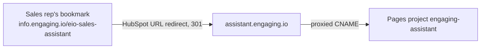

# The sales assistant

A password-protected chat page (the home page, `/`) for Engaging's sales reps, replacing the HubSpot page
`info.engaging.io/eio-sales-assistant`. It answers questions about Engaging's services and case studies from a
knowledge base in `knowledge/`, through a model behind Cloudflare AI Gateway.
How the pieces connect is in [Architecture and resources](../architecture/overview.md); this page is how to run
it day to day.

| Task                         | How                                                                                   |
| ---------------------------- | ------------------------------------------------------------------------------------- |
| Change the model             | `./cli.sh ai-config` ([below](#change-the-model))                                     |
| Rotate a provider key        | AI Gateway dashboard, or `./cli.sh set-agent-secret` ([below](#rotate-provider-keys)) |
| Edit the knowledge base      | A pull request to `knowledge/`, checked by `pnpm kb:check`                            |
| Publish the knowledge base   | Merge to `main`, or `./cli.sh kb-publish`                                             |
| Roll the knowledge base back | `./cli.sh ai-config`, set an earlier `kbVersion`                                      |
| See what is live             | `GET /api/health` shows `kbVersion` and `model`                                       |

Notion is not part of this setup: the knowledge base is the markdown in `knowledge/` and nothing else.

## Change the model

The agent Worker reads its runtime config from the KV key `config` (namespace `engaging-assistant-config`) at most 60
seconds after it changes, so a model change needs no deploy. `./cli.sh ai-config` shows the saved config (or the
defaults when none is saved), opens it in `$EDITOR`, checks it against the `AssistantConfig` schema in
`shared/protocol` and saves it after asking.

| Field             | Default             | Meaning                                                                                               |
| ----------------- | ------------------- | ----------------------------------------------------------------------------------------------------- |
| `provider`        | `anthropic`         | `anthropic`, `openai` or `google`                                                                     |
| `model`           | `claude-sonnet-5-5` | The provider's model ID, as its API names it                                                          |
| `maxOutputTokens` | `16000`             | Longest reply, 1 to 64,000 tokens                                                                     |
| `effort`          | `low`               | Optional. `low`, `medium` or `high`: Anthropic `effort`, OpenAI `reasoningEffort`; ignored for Google |
| `temperature`     | not set             | Optional, 0 to 2. Leave it out unless the model needs it                                              |
| `webFetch`        | `true`              | Whether the model may use `fetchPage` (2 pages per turn, never engaging.io or private addresses)      |
| `maxHistory`      | `30`                | How many of the latest messages are sent with each turn, 2 to 100                                     |
| `kbVersion`       | `""`                | The published knowledge base to answer from. Set by `kb-publish`; change it by hand only to roll back |

An invalid saved config is ignored (the Worker logs `config invalid` and uses the defaults), and the CLI refuses
to save one. A switch to another provider needs that provider's key in the gateway or on the Worker first.

## Rotate provider keys

The agent calls every provider through AI Gateway (`engaging-assistant-assistant`) and authenticates to the gateway with the
Worker secret `CF_AIG_TOKEN`. The provider keys themselves live in one of two places:

| Where                                                                                                           | Rotate by                                                                                      |
| --------------------------------------------------------------------------------------------------------------- | ---------------------------------------------------------------------------------------------- |
| AI Gateway stored keys (BYOK, "bring your own key"): the preferred place                                        | Dashboard: **AI → AI Gateway → engaging-assistant-assistant → Provider keys**, replace the key |
| Secrets on the agent Worker `engaging-assistant-agent`: `ANTHROPIC_API_KEY`, `OPENAI_API_KEY`, `GOOGLE_API_KEY` | `./cli.sh set-agent-secret ANTHROPIC_API_KEY` (runs `wrangler secret put`)                     |

A Worker secret wins over the gateway's stored key when both exist. Both take effect on the next request, with no
deploy. To rotate `CF_AIG_TOKEN` itself, create a new token in the gateway's **Settings → Authentication**, run
`./cli.sh set-agent-secret CF_AIG_TOKEN`, then delete the old token. With neither a gateway token nor the
provider's own key, the assistant answers with its fallback message ("Sorry, something went wrong on our side…").

## Edit and publish the knowledge base

Non-developers edit on github.com with [`knowledge/EDITING.md`](../../knowledge/EDITING.md) (pencil icon, pull
request, the check, a reviewer merges). The full technical guide is [`knowledge/README.md`](../../knowledge/README.md): file format, statuses (`published`,
`anonymous`, `reference`, `draft`, `excluded`, `never_disclose`), what `pnpm kb:check` enforces, and publishing.
In short:

1. Edit or add a file in `knowledge/case-studies/`, or `knowledge/instructions.md` (the system prompt).
2. `./cli.sh kb-check` until it passes, then open a pull request; CI runs the same check.
3. Merging to `main` publishes it (`.github/workflows/kb.yml`). `./cli.sh kb-publish` does the same by hand.
4. Within a minute, `/api/health` shows the new `kbVersion`.

## Roll back

Every published version stays in the R2 bucket `engaging-assistant-kb` under `kb/<version>/`. Run `./cli.sh ai-config`,
set `kbVersion` to the earlier version (printed by that publish, or in its CI log) and save. Revert the change in
Git too, or the next merge publishes it again. A code rollback is separate: see
[Deploy → Rolling back](../operations/deploy.md#rolling-back).

## The page and its password

The home page is a copy of the HubSpot page it replaces, `info.engaging.io/eio-sales-assistant`: the same dark layout,
fonts (Atkinson Hyperlegible Next, JetBrains Mono), suggestion buttons, "Searching my knowledge" indicator and
awards footer. Like that page it asks for one shared password first.

| View         | When                                      | Shows                                                                 |
| ------------ | ----------------------------------------- | --------------------------------------------------------------------- |
| Password     | No valid `chat_access` cookie             | The password box and "Access the assistant"                           |
| Start screen | Unlocked, no messages yet                 | Intro, four suggestion buttons, the question box, the awards footer   |
| Conversation | After the first question (or on a reload) | Messages, the question box pinned to the bottom, "Start a new search" |

The password is checked on the server, not in the page:

1. The page calls `GET /api/access`, which answers `{ "unlocked": true | false }` from the `chat_access` cookie.
2. The form sends `POST /api/access` with `{ "password": "..." }`. The Function compares it with the Pages secret
   `CHAT_PASSWORD` in constant time and, if it matches, sets `chat_access` for 7 days (`HttpOnly`, `Secure`,
   `SameSite=Lax`). Five attempts a minute per IP are allowed (`UNLOCK_LIMIT` on the agent Worker), then 429.
3. The `/agents` proxy refuses every chat request without a valid `chat_access` (401 "Password required") before
   the connect limit and Turnstile, so the password guards the assistant itself, not only the page.

| Task                       | How                                                                                    |
| -------------------------- | -------------------------------------------------------------------------------------- |
| Set or change the password | `./cli.sh set-secret CHAT_PASSWORD`, then `./cli.sh deploy-pages` (signs everyone out) |
| Sign everyone out          | Change the password, or rotate `PASS_SECRET` (also ends every `chat_pass`)             |
| Local password             | `CHAT_PASSWORD` in `backend/api/.dev.vars` (default `engaging-dev-password`)           |

The cookie holds only an expiry and an HMAC (a keyed hash) over it and the current password, never the password.
Anyone who knows the password can use the assistant and get the knowledge base's content out of it by asking, so
treat the password like the content: share it with the sales team only, and change it when someone leaves.
`GET /api/health` stays public and reports the live `model` and `kbVersion`.

The page can no longer be framed (`frame-ancestors 'none'` in `web/static/_headers`): browsers would not send
the `SameSite=Lax` cookie inside another site's iframe, so it is a page of its own.

## Move the old HubSpot URL here

`info.engaging.io` is a HubSpot website domain: its DNS record (in the `engaging.io` Cloudflare zone) is a
DNS-only CNAME to `435515.group15.sites.hubspot.net`, so HubSpot serves every page on it. One path of a hostname
cannot be pointed somewhere else in DNS, so the move is in two parts: give the Cloudflare chat its own hostname,
then have HubSpot redirect the old URL to it. HubSpot keeps serving the rest of `info.engaging.io`.



1. **Custom domain.** In a gitignored `backend/infra/terraform.tfvars`, set `zone_name = "engaging.io"` and
   `custom_domains = ["assistant.engaging.io"]` (any free name works). The `engaging.io` zone must be in the same
   Cloudflare account as the Pages project; if it is in another one, add the domain in the dashboard instead
   (**Workers & Pages → engaging-assistant → Custom domains**). Then `./cli.sh deploy`: its Terraform step creates the
   `cloudflare_pages_domain` and the proxied CNAME, and `infra-write-config` adds the new origin to production
   `ALLOWED_ORIGINS` (commit `backend/api/wrangler.toml`). Turnstile picks the domain up from the same variable.
2. **Check it.** Open `https://assistant.engaging.io` once the certificate is issued (a few minutes), enter the
   password and ask a question.
3. **Redirect in HubSpot.** In HubSpot, **Settings → Content → Domains & URLs → URL Redirects → Add URL redirect**:
   original URL `info.engaging.io/eio-sales-assistant`, destination `https://assistant.engaging.io/`,
   permanent (301). A redirect does not apply while a live page has the same URL, so first unpublish (or archive)
   the old page in **Content → Website Pages**, or tick the redirect's option to apply even when a page exists.
4. **Test the old URL** in a private window: it should land on the new password view.
5. **Retire the old assistant** once nobody uses it: the HubSpot module connects to its own server
   (`eio-ai-assist.ec7.co`), which can then be shut down.

Rolling back is deleting (or pausing) the HubSpot redirect and republishing the old page.

## Costs

| Item            | Cost                                                                                                                                                       |
| --------------- | ---------------------------------------------------------------------------------------------------------------------------------------------------------- |
| Cloudflare      | The Workers Paid plan, about $5 a month; at a sales team's volume Pages, Durable Objects, KV and R2 stay within its included usage, and AI Gateway is free |
| Model (default) | Per question, below. Almost all of it is the knowledge base sent as the system prompt                                                                      |

The knowledge base goes with every question, so the agent marks it for Anthropic prompt caching with a 1-hour TTL
(time to live): the first question writes it to the cache, and every question in the next hour, from any chat,
reads it from there for a fraction of the price. Each cache read resets the hour. OpenAI and Google cache
automatically.

For Claude Sonnet 5.5 with the knowledge base at about 154,000 tokens, at $2 / $10 per million input / output
tokens, $4 per million for a 1-hour cache write and $0.10 per million for a cache read (check Anthropic's pricing
page for current prices):

| Question                                   | Approximate cost |
| ------------------------------------------ | ---------------- |
| Cold: first in an hour (cache write)       | $0.61            |
| Warm: any other (cache read, short answer) | $0.03            |

A larger knowledge base costs proportionally more; `pnpm kb:check` prints its size.

### Reading AI Gateway analytics

Dashboard: **AI → AI Gateway → engaging-assistant-assistant**.

| Tab       | Shows                                                                                             |
| --------- | ------------------------------------------------------------------------------------------------- |
| Analytics | Requests, tokens, estimated cost and errors over time, per provider and model                     |
| Logs      | Each model call: status, duration, tokens in and out, cost. Open one to see the request and reply |

A warm question shows most of its input tokens as cached; when nearly every call shows a cache write instead,
questions are more than an hour apart or the knowledge base changed. The agent Worker also logs one line per
answer, a JSON `usage` object with `in`, `cacheRead`, `cacheWrite`, `out` and `model`, visible in **Workers & Pages → engaging-assistant-agent
→ Logs**. The gateway's rate limit (300 requests per 60 s) is a ceiling on spend; errors with status 429 there
mean it was reached.

## Content review needed

`pnpm kb:check` guarantees that never-disclose names and anonymous clients' real names are not uploaded. It cannot
judge whether other details give a client away, or whether a draft says too much. A content owner should review:

| File in `knowledge/case-studies/`                                                                          | What to check                                                                                            |
| ---------------------------------------------------------------------------------------------------------- | -------------------------------------------------------------------------------------------------------- |
| `a-nsw-government-entity-managing-cemetery-and-memorial.md`                                                | The entity's history (when and why it was set up, what it manages, place names) identifies it            |
| `a-luxury-hospitality-group-operating-a-hotel-restaurant-and.md`                                           | Its awards and farm details identify it                                                                  |
| `a-miami-based-stadium-and-its-major-sports-and.md`, `a-miami-based-stadium-its-motorsport-event-brand.md` | The mix of events (football team, motorsport event, tennis tournament, concerts) identifies the stadium  |
| `akolade.md`, `great-place-to-work.md` (`draft`)                                                           | The build strips results sections and quotes from drafts, but the summary paragraph still quotes metrics |

## Locally

The dev stack (`./cli.sh up`) runs the agent Worker with `MOCK_MODEL=echo` from `backend/agent/.dev.vars`
(copied from `.dev.vars.example` on first start): every answer is `echo: <your message>`, costs nothing and
needs no key. To try a real model with only an Anthropic key, edit `backend/agent/.dev.vars`, then restart the
stack (`./cli.sh down`, `./cli.sh up`):

```
# MOCK_MODEL=echo
AI_GATEWAY_URL=
ANTHROPIC_API_KEY=sk-ant-...
```

An empty `AI_GATEWAY_URL` makes the agent call the provider directly instead of through AI Gateway. It only
works locally: `.dev.vars` is never deployed, and `scripts/check-synced.sh` refuses to deploy unless
`backend/agent/wrangler.toml` holds a full gateway URL. To go through a real gateway instead, set
`AI_GATEWAY_URL` to its URL and add `CF_AIG_TOKEN` if the gateway has authentication on.

The local agent reads the local KV and R2 in `.wrangler/state`, which start empty: until a knowledge base is
published there it answers with the fallback message. `./cli.sh kb-publish-local` builds `knowledge/` and
writes it there (`scripts/kb/publish.sh --local`; no account, never `--remote`). `./cli.sh e2e` runs it before
every run, so the chat test (`e2e/tests/chat.spec.ts`: send `hi`, expect `echo: hi`, reload, expect it again
from the stored history) always has one. Turnstile uses its always-pass test keys, so the browser and the API
need internet access.
