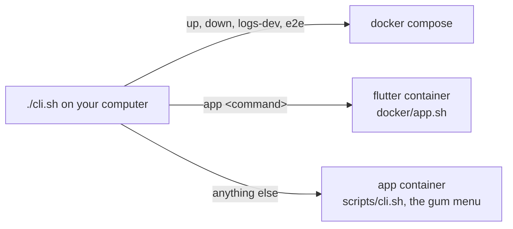

# The project CLI

`./cli.sh` at the repo root is the one entry point. With no arguments it opens a menu (built with
[gum](https://github.com/charmbracelet/gum)); with an action name it runs that action directly.

```bash
./cli.sh            # the menu
./cli.sh help       # every action
./cli.sh deploy     # one action
```

## How it runs



`./cli.sh` itself only needs Docker. It starts the dev stack if needed and runs `scripts/cli.sh` inside the `app`
container, where gum, pnpm, Wrangler and Terraform live. Mobile commands go to the Flutter container instead.

## Actions

| Group            | Action                                | Does                                                                         |
| ---------------- | ------------------------------------- | ---------------------------------------------------------------------------- |
| On your computer | `up` / `down`                         | Start or stop the dev stack                                                  |
|                  | `logs-dev`                            | Follow the dev stack's output                                                |
|                  | `e2e [filter]`                        | Playwright tests against the dev stack                                       |
|                  | `app <command>`                       | The Flutter app ([Mobile app](mobile.md))                                    |
| Checks           | `check-all`                           | Typecheck, lint and test                                                     |
|                  | `test`, `typecheck`, `lint`, `format` | One at a time                                                                |
| Local            | `build`                               | Build the website into `web/build`                                           |
|                  | `install`                             | `pnpm install` (after editing a `package.json`)                              |
|                  | `outdated`                            | Packages with newer versions                                                 |
|                  | `rename`                              | Rename the starter for a new project ([Start a new project](new-project.md)) |
| Cloudflare setup | `first-setup`                         | Wizard for a new account: tokens, state bucket, Terraform, deploy, health    |
|                  | `whoami`                              | Which Cloudflare account Wrangler is using                                   |
|                  | `set-secret`                          | Set a Pages secret (read in Functions as `env.NAME`)                         |
|                  | `list-secrets`                        | Secret names (never values)                                                  |
|                  | `forget-token`                        | Delete `.env.cloudflare`                                                     |
| Infrastructure   | `tokens`                              | Create the three API tokens ([Deploy](../operations/deploy.md#credentials))  |
|                  | `infra-bootstrap`                     | Create the Terraform state bucket (once per account)                         |
|                  | `infra-plan`                          | Show what Terraform would change                                             |
|                  | `infra-apply`                         | Make the changes (asks first)                                                |
|                  | `infra-output`                        | The Pages address and domain status                                          |
|                  | `infra-check`                         | `terraform fmt -check` and `validate`, no account needed                     |
|                  | `deploy-token`                        | Show the deploy token, for GitHub Actions                                    |
| Deploy           | `deploy`                              | Terraform (if anything changed), build, deploy Pages, health check           |
|                  | `deploy-pages`                        | Build and deploy Pages only                                                  |
|                  | `deploy-preview`                      | Deploy a preview at `https://<branch>.<project>.pages.dev`                   |
|                  | `deployments`                         | Recent deployments                                                           |
|                  | `logs`                                | Stream production Function logs                                              |
|                  | `health`                              | `GET /api/health` on the live site                                           |

## Credentials

Cloudflare actions read `CLOUDFLARE_API_TOKEN` and `CLOUDFLARE_ACCOUNT_ID` from the environment or from
`.env.cloudflare` (ignored by Git and Docker builds). `./cli.sh tokens` writes that file; or the CLI asks for a
token the first time and offers to remember it. A `wrangler login` inside the container works too, for Wrangler
actions only.

## Adding an action

In `scripts/cli.sh`:

1. Write a function `act_<name>()`. Use the helpers: `run` (shows and runs a command), `title`, `note`, `ok`,
   `fail`, `confirm`, and `ensure_cloudflare` before anything that talks to Cloudflare.
2. Add a line `name|Label` to one of the `MENU_*` lists. It then shows in the menu and in `./cli.sh help`, and
   runs as `./cli.sh name` (dashes and underscores are interchangeable).
