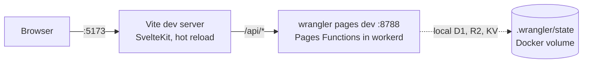

# Run it locally

Everything runs in Docker. Your computer needs Docker (Docker Desktop on Windows and macOS, Docker Engine on
Linux) and, on Windows, Git Bash for `./cli.sh`.

## Start

```bash
./cli.sh up
```

| Address                 | What                                                                                                  |
| ----------------------- | ----------------------------------------------------------------------------------------------------- |
| <http://localhost:5173> | The site from Vite, with hot reload. `/api` is passed through to the Functions. Use this one.         |
| <http://localhost:8788> | `wrangler pages dev`: the Functions plus the last `pnpm build` of the site, as Cloudflare serves them |
| <http://localhost:3000> | These docs                                                                                            |

The first start downloads packages into a Docker volume (a minute); later starts take seconds. Stop with
`./cli.sh down`; follow the output with `./cli.sh logs-dev`.



The browser talks to Vite; Vite hands every `/api` request to Wrangler, which runs the Functions in workerd,
the same runtime as production.

## The containers

| Service | Image                         | Starts         | Purpose                                                  |
| ------- | ----------------------------- | -------------- | -------------------------------------------------------- |
| `app`   | `cloudie-dev:local` (~200 MB) | `./cli.sh up`  | Node 26, pnpm, Wrangler, Terraform, gum. Runs `pnpm dev` |
| `docs`  | `node:26-alpine`              | `./cli.sh up`  | Serves `docs/` read-only                                 |
| `e2e`   | Playwright                    | `./cli.sh e2e` | End-to-end tests against the running `app`               |

Why it stays light:

- **Packages are not baked into the image.** `docker/dev-entrypoint.sh` runs `pnpm install` on start against a
  cached store volume. Editing a `package.json` never needs an image rebuild, only `./cli.sh install`.
- **`node_modules` live in volumes**, not in the repo folder, so Windows and macOS file sharing never has to sync
  them.
- Rebuild the image (`docker compose build app`) only when a version in `docker/Dockerfile.dev` changes.

## Ports

If another project already uses a port (two projects from this starter, say), copy `.env.example` to `.env` and
change them:

```bash
cp .env.example .env   # then edit WEB_PORT, API_PORT, DOCS_PORT
```

## File changes not picked up (Windows, macOS)

File-change events don't always cross the Docker bind mount. Set `CHOKIDAR_USEPOLLING=true` in `.env` and run
`./cli.sh up` again.

## Checks

```bash
./cli.sh check-all     # typecheck, lint, tests
./cli.sh e2e           # Playwright (desktop and phone sizes); screenshots and traces in test-results/e2e
```

Or one at a time inside the container: `docker compose exec app pnpm test | typecheck | lint | format`.

| Check      | Tool                                                                       |
| ---------- | -------------------------------------------------------------------------- |
| Typecheck  | `tsc` per package, `svelte-check` for the website                          |
| Lint       | ESLint 10 (flat config, `eslint.config.js`) and Prettier                   |
| Unit tests | Vitest 5. API tests run inside workerd through `@cloudflare/vitest-plugin` |
| End to end | Playwright against the dev stack (`e2e/tests`)                             |

## A shell in the container

```bash
docker compose exec app bash
```

`pnpm`, `wrangler` (`pnpm --filter api exec wrangler …`), `terraform` and `gum` are all there.
