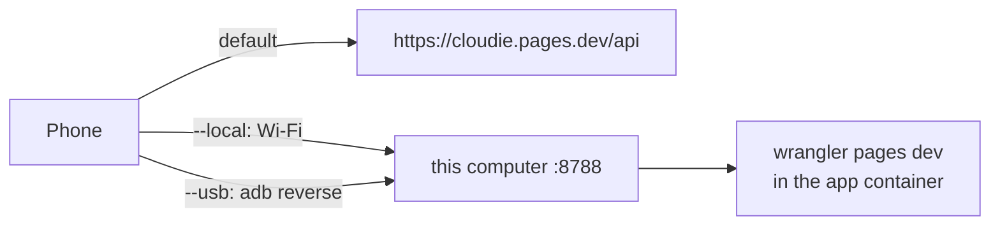

# Mobile app (Android, iOS)

`mobile/` is one Flutter project for Android and iOS. It calls the same `/api` routes as the website. Out of the
box it shows the hello-world greeting from `GET /api/hello`.

Everything Android runs in the `flutter` container (Flutter 3.50, Android SDK, JDK 21), so your computer still
only needs Docker. The first `./cli.sh app …` builds that image (a few minutes, about 3 GB).

## Where things are

| Path                              | What                                                                   |
| --------------------------------- | ---------------------------------------------------------------------- |
| `mobile/lib/main.dart`            | App entry, theme, routes (`go_router`)                                 |
| `mobile/lib/config.dart`          | `API_ORIGIN`, app id, build label (set per build with `--dart-define`) |
| `mobile/lib/api/client.dart`      | JSON over HTTP; reply classes mirror `shared/protocol/src/index.ts`    |
| `mobile/lib/state/app_state.dart` | App-wide state, a plain `ChangeNotifier`                               |
| `mobile/lib/features/<name>/`     | One folder per screen                                                  |
| `mobile/test/`                    | Unit and widget tests (`./cli.sh app test`)                            |
| `mobile/android/`, `mobile/ios/`  | Platform projects, generated by `flutter create`, committed            |
| `mobile/assets/branding/`         | Icon sources for `./cli.sh app icons`                                  |
| `docker/app.sh`                   | What every `./cli.sh app` command runs                                 |

State stays deliberately simple: `ChangeNotifier` plus `ListenableBuilder`, `go_router` for navigation and
`package:http` for the API. Add a state library only when a screen really needs one.

## Commands

| Command                             | Does                                                                          |
| ----------------------------------- | ----------------------------------------------------------------------------- |
| `./cli.sh app apk`                  | Debug APK in `mobile/out/`, talking to the deployed site                      |
| `./cli.sh app apk --local`          | …talking to the dev stack on this computer over Wi-Fi                         |
| `./cli.sh app apk --usb`            | …talking to the dev stack through the USB cable (`adb reverse`)               |
| `./cli.sh app share`                | QR code: scan it on a phone on the same Wi-Fi to download and install the APK |
| `./cli.sh app install`              | Install the APK over USB                                                      |
| `./cli.sh app run [--local\|--usb]` | `flutter run` with hot reload on a USB phone                                  |
| `./cli.sh app test` / `analyze`     | Flutter tests, static analysis                                                |
| `./cli.sh app build`                | Signed release `.aab` and `.apk` for Google Play                              |
| `./cli.sh app icons`                | Launcher icons and splash screen from `assets/branding/`                      |
| `./cli.sh app shell` / `image`      | A shell in the Flutter container; rebuild its image                           |



A debug build bakes in where its API is; the build label at the bottom of the screen shows which one.

### USB phones

The container uses **your computer's** adb server (`ADB_SERVER_SOCKET=tcp:host.docker.internal:5037`), so the
phone stays plugged into your computer. Start adb so it listens beyond localhost:

```bash
adb kill-server; adb -a start-server
```

No adb? `./cli.sh app share` installs over Wi-Fi from a QR code instead.

## Releasing to Google Play

1. Create the upload key once, inside `./cli.sh app shell`:
   `keytool -genkey -v -keystore /app/mobile/android/upload-keystore.jks -keyalg RSA -keysize 2048 -validity 10000 -alias upload`
2. Write `mobile/android/key.properties` (ignored by Git, like the `.jks`):

   ```properties
   storeFile=../upload-keystore.jks
   storePassword=...
   keyAlias=upload
   keyPassword=...
   ```

3. Raise `version:` in `mobile/pubspec.yaml`. The number after `+` must go up for every upload.
4. `./cli.sh app build`, then upload `mobile/out/cloudie-<version>.aab` in the Play Console.

`mobile/android/app/build.gradle.kts` signs with that key when `key.properties` exists. Keep a backup of the
`.jks` and its passwords outside the repo: losing them means a new app listing.

## iOS

`mobile/ios/` is generated with the bundle id from `mobile/lib/config.dart`. Building for iOS needs macOS with
Xcode and CocoaPods, which can't run in Docker, so there is no `./cli.sh app` command for it. On a Mac with
Flutter 3.50:

```bash
cd mobile
flutter pub get
flutter build ipa --dart-define=API_ORIGIN=https://cloudie.pages.dev
```

Set the Apple Developer team in Xcode (`ios/Runner.xcworkspace` → Runner → Signing & Capabilities), then upload
the `.ipa` with Xcode or Transporter.

## CI

The `mobile` job in `.github/workflows/ci.yml` runs `flutter analyze` and `flutter test` with the same Flutter
version as `docker/flutter.Dockerfile`. It does not build or sign releases.

## Upgrading Flutter

1. Change `FLUTTER_VERSION` and `FLUTTER_SHA256` in `docker/flutter.Dockerfile` (both from
   [the releases JSON](https://storage.googleapis.com/flutter_infra_release/releases/releases_linux.json)),
   and `flutter-version` in `.github/workflows/ci.yml`.
2. `./cli.sh app image`, then `./cli.sh app analyze`, `test` and `apk`.
