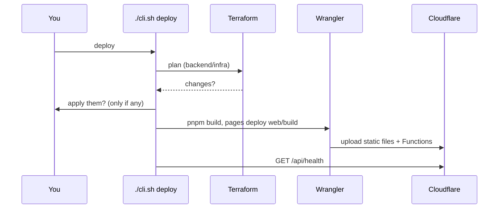

# Deploy to Cloudflare

## First time, on a new account

```bash
./cli.sh first-setup
```

The wizard runs these steps, each one skippable:

| Step                      | Action            | Creates                                                                |
| ------------------------- | ----------------- | ---------------------------------------------------------------------- |
| 1. API tokens             | `tokens`          | Three tokens, saved to `.env.cloudflare` ([Credentials](#credentials)) |
| 2. Terraform state bucket | `infra-bootstrap` | Private R2 bucket `cloudie-tfstate`                                    |
| 3. Infrastructure         | `infra-apply`     | Pages project `cloudie` (and custom domains, if set)                   |
| 4. Build and deploy       | `deploy-pages`    | The first production deployment at `https://cloudie.pages.dev`         |
| 5. Health check           | `health`          | Nothing; checks `GET /api/health` answers                              |

Prefer not to use Terraform? Skip steps 1–3, run `./cli.sh deploy-pages` with any token that has
**Pages Write**: Wrangler creates the project on the first deploy.

## Every deploy

```bash
./cli.sh deploy
```



Infrastructure goes first, so code never goes out before what it depends on. A preview, at its own address with
production untouched: `./cli.sh deploy-preview`.

## From GitHub Actions

`.github/workflows/ci.yml` has a `deploy` job that runs after the checks on every push to `main`. It deploys
code only (no Terraform, which needs the admin token). To turn it on:

1. `./cli.sh deploy-token` and save it as the repository **secret** `CLOUDFLARE_API_TOKEN`.
2. Repository **variables**: `CLOUDFLARE_ACCOUNT_ID`, and `DEPLOY_ENABLED` = `true`.

## Credentials

`./cli.sh tokens` makes three API tokens from one temporary token, so nobody clicks through permission lists:

| Token                     | Can                                                      | Used by                  |
| ------------------------- | -------------------------------------------------------- | ------------------------ |
| `cloudie-terraform-admin` | Everything on the account except managing tokens         | Terraform                |
| `cloudie-terraform-state` | Read and write the state bucket only (as an S3 key pair) | Terraform's backend      |
| `cloudie-deploy`          | `Account Settings Read`, `Pages Write`                   | Wrangler, GitHub Actions |

1. In the dashboard: **My Profile → API Tokens → Create Token**, template **Create Additional Tokens**,
   create it and copy it.
2. `./cli.sh tokens`, paste it. The tokens expire in a year; run it again to rotate (it offers to delete the old
   ones and the temporary token).

All of them land in `.env.cloudflare`, which Git and Docker builds ignore. Never commit it.

## Custom domain

The domain must be a zone in the same Cloudflare account. In `backend/infra/variables.tf` (or a
`terraform.auto.tfvars`):

```hcl
zone_name      = "example.com"
custom_domains = ["app.example.com"]
```

`./cli.sh infra-apply` adds the domain to the Pages project and its DNS record. `./cli.sh infra-output` shows
when it is active (usually a few minutes, for the certificate).

## Rolling back

Pages keeps every deployment. In the dashboard: **Workers & Pages → cloudie → Deployments**, pick an earlier one,
**Rollback to this deployment**. `./cli.sh deployments` lists them.
