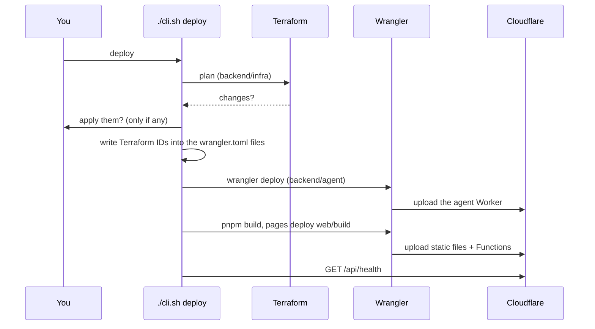

# Deploy to Cloudflare

## First time, on a new account

```bash
./cli.sh first-setup
```

The wizard runs these steps, each one skippable:

| Step                      | Action               | Creates                                                                                                                 |
| ------------------------- | -------------------- | ----------------------------------------------------------------------------------------------------------------------- |
| 1. API tokens             | `tokens`             | Three tokens, saved to `.env.cloudflare` ([Credentials](#credentials))                                                  |
| 2. Terraform state bucket | `infra-bootstrap`    | Private R2 bucket `engaging-assistant-tfstate`                                                                          |
| 3. Infrastructure         | `infra-apply`        | Pages project `engaging-assistant` (and custom domains, if set), KV, R2, AI Gateway, Turnstile                          |
| 4. IDs into code          | `infra-write-config` | The KV id, AI Gateway URL and production `ALLOWED_ORIGINS` in the two `wrangler.toml` files (commit them)               |
| 5. Agent Worker           | `deploy-agent`       | The Worker `engaging-assistant-agent` (Pages' `AGENT` binding and the agent secret need it to exist)                    |
| 6. Secrets                | (wizard only)        | `TURNSTILE_SECRET` (read from Terraform), `PASS_SECRET` (generated), `CHAT_PASSWORD` and `CF_AIG_TOKEN` (you type them) |
| 7. Build and deploy       | `deploy-pages`       | The first production deployment at `https://engaging-assistant.pages.dev`                                               |
| 8. Knowledge base         | `kb-publish`         | The first `kbVersion`; until then the chat answers only with its fallback message                                       |
| 9. Health check           | `health`             | Nothing; checks `GET /api/health` answers                                                                               |

The assistant needs every step: Terraform creates its KV, R2, AI Gateway and Turnstile widget, so there is no
path without it.

## Assistant secrets and variables

The wizard sets these once. To set or rotate one by hand (full commands in
[Infrastructure → Assistant resources](../../backend/infra/README.md#assistant-resources)):

| What                                             | Where                                                 | How                                                           |
| ------------------------------------------------ | ----------------------------------------------------- | ------------------------------------------------------------- |
| `TURNSTILE_SECRET`                               | Pages secret                                          | `./cli.sh set-secret TURNSTILE_SECRET`                        |
| `PASS_SECRET`                                    | Pages secret                                          | `./cli.sh set-secret PASS_SECRET` (`openssl rand -base64 32`) |
| `CHAT_PASSWORD` (the chat page's password)       | Pages secret                                          | `./cli.sh set-secret CHAT_PASSWORD`                           |
| `CF_AIG_TOKEN` (AI Gateway token), provider keys | Secret on the agent Worker `engaging-assistant-agent` | `./cli.sh set-agent-secret CF_AIG_TOKEN`                      |
| `PUBLIC_TURNSTILE_SITEKEY`                       | GitHub repository **variable** (CI only)              | The value of `pnpm tf output -raw turnstile_sitekey`          |

`./cli.sh deploy` reads the sitekey from Terraform itself. Production `ALLOWED_ORIGINS` (the chat page's own
addresses, never HubSpot's) is written into `backend/api/wrangler.toml` from the `chat_origins` output; commit it.
Secrets set on the agent Worker need the Worker to exist (`./cli.sh deploy-agent`), and a Pages secret takes
effect on the next Pages deploy. Day-to-day operation (model, keys, the chat password, the old HubSpot URL, costs) is in
[The sales assistant](../guide/assistant.md).

## Every deploy

```bash
./cli.sh deploy
```



Infrastructure goes first, so code never goes out before what it depends on, and the agent Worker goes before
Pages because the Pages project's `AGENT` service binding needs that Worker to exist. A preview, at its own address with
production untouched: `./cli.sh deploy-preview`.

## From GitHub Actions

`.github/workflows/ci.yml` has a `deploy` job that runs after the checks on every push to `main`. It deploys
code only (no Terraform, which needs the admin token): the agent Worker, then Pages. It uses the IDs committed in
the `wrangler.toml` files, so run `./cli.sh deploy` locally (and commit) after infrastructure changes. To turn it on:

1. `./cli.sh deploy-token` and save it as the repository **secret** `CLOUDFLARE_API_TOKEN`.
2. Repository **variables**: `CLOUDFLARE_ACCOUNT_ID`, `PUBLIC_TURNSTILE_SITEKEY` (from the `turnstile_sitekey`
   output) and `DEPLOY_ENABLED` = `true`.

## Credentials

`./cli.sh tokens` makes three API tokens from one temporary token, so nobody clicks through permission lists:

| Token                                | Can                                                                                                                     | Used by                  |
| ------------------------------------ | ----------------------------------------------------------------------------------------------------------------------- | ------------------------ |
| `engaging-assistant-terraform-admin` | Everything on the account except managing tokens                                                                        | Terraform                |
| `engaging-assistant-terraform-state` | Read and write the state bucket only (as an S3 key pair)                                                                | Terraform's backend      |
| `engaging-assistant-deploy`          | `Account Settings Read`, `Pages Write`, `Workers Scripts Write`, `Workers KV Storage Write`, `Workers R2 Storage Write` | Wrangler, GitHub Actions |

1. In the dashboard: **My Profile → API Tokens → Create Token**, template **Create Additional Tokens**,
   create it and copy it.
2. `./cli.sh tokens`, paste it. The tokens expire in a year; run it again to rotate (it offers to delete the old
   ones and the temporary token).

All of them land in `.env.cloudflare`, which Git and Docker builds ignore. Never commit it.

## Custom domain

The domain must be a zone in the same Cloudflare account. In `backend/infra/variables.tf` (or a
`terraform.auto.tfvars`):

```hcl
zone_name      = "example.com"
custom_domains = ["app.example.com"]
```

`./cli.sh infra-apply` adds the domain to the Pages project and its DNS record. `./cli.sh infra-output` shows
when it is active (usually a few minutes, for the certificate).

## Rolling back

Pages keeps every deployment. In the dashboard: **Workers & Pages → engaging-assistant → Deployments**, pick an earlier one,
**Rollback to this deployment**. `./cli.sh deployments` lists them. The agent Worker keeps its versions too
(**Workers & Pages → engaging-assistant-agent → Deployments**), and a knowledge base is rolled back by its `kbVersion`
([The sales assistant → Roll back](../guide/assistant.md#roll-back)).
