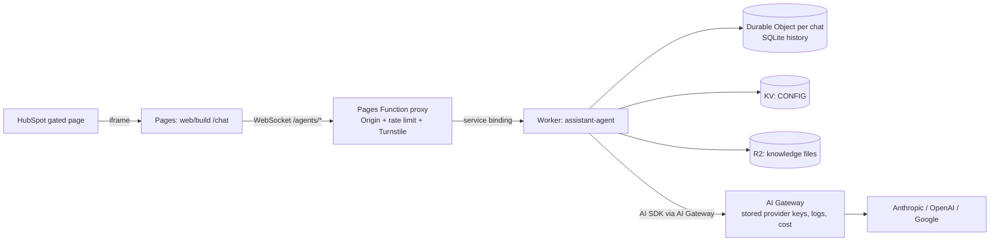

# Engaging.io Sales Assistant on Cloudflare: design and plan

## Context

Engaging.io's sales assistant (`../engaging-assistant`) helps HubSpot sales reps find case studies. Reps reach it on a gated HubSpot page. Today it runs like this:

- **Server:** a Node and `ws` server on cPanel under PM2, deployed by scp with a password.
- **Model:** Claude Sonnet through `@anthropic-ai/sdk`, with the server-side `web_fetch` tool.
- **Knowledge base:** 5 markdown files of about 600 KB (about 150k tokens), read once at startup and put whole into the system prompt with 1 hour prompt caching.
- **Weak points:**
  - Sessions live in memory and are lost on restart.
  - There is no Origin check and no rate limiting.
  - The model's raw HTML is injected into the page.
  - Confidential client names are protected only by the prompt.
  - Changing the model or a knowledge file means a restart or redeploy.
- **Chat window:** lives in HubSpot Design Manager and talks to `/ws`.

**Goal:** rebuild it entirely on Cloudflare, managed with Terraform. It must be cheap to run, and the AI model, its settings and the provider keys must be changeable without a code redeploy. It uses the Vercel AI SDK. The Flutter app is removed.

**Decided with the user:**

| Decision | Choice                                                                                                                                                                                 |
| -------- | -------------------------------------------------------------------------------------------------------------------------------------------------------------------------------------- |
| Hosting  | Everything on Cloudflare: page, WebSocket, backend                                                                                                                                     |
| Access   | The chat page is embedded as an iframe in the existing gated HubSpot page, so the Cloudflare URL is public and has to protect itself                                                   |
| Approach | A: Cloudflare Agents SDK (`AIChatAgent` from `@cloudflare/ai-chat`, built on AI SDK `streamText`) in a separate Worker with one Durable Object per conversation. Pages keeps the site. |

## Architecture

- **Same origin:** the Pages Function `functions/agents/[[path]].ts` forwards the WebSocket upgrade to the Worker through a service binding. The browser only sees one host, and every guard runs in Pages middleware.
- **Agent Worker:** `backend/agent/` holds a new Worker. It exports `SalesAgent extends AIChatAgent` and has its own wrangler.toml, Durable Object migration (`new_sqlite_classes`), and bindings for KV, R2 and the AI Gateway.
- **Chat page:** `web/src/routes/chat/` is prerendered and embedded by HubSpot. A small Svelte 5 wrapper sits around `AgentClient` (`agents/client`) and the AI SDK chat transport; the wrapper is our own code.
  - Replies render as markdown with `marked` and `DOMPurify`. That replaces raw HTML, so `instructions.md` changes its output section to markdown.
  - A session id is kept in `sessionStorage`, so reloading resumes the chat (history comes from Durable Object SQLite).
- **Guards for a public URL:**
  1. Origin and `frame-ancestors` CSP allow only the HubSpot domain (a Terraform or wrangler variable).
  2. A Turnstile token is checked when the WebSocket opens.
  3. Workers Rate Limiting binding: 20 messages per minute per IP.
  4. Message length is capped at 4000 characters.
  5. AI Gateway rate limiting acts as a global ceiling.
- **Link safety in code:** the Worker builds the URL allowlist from the knowledge base index. The client strips any link in a reply whose URL is not on that list.

## Changing the model and settings without a redeploy

- **KV key `config`:** JSON validated by a `zod/mini` schema `AssistantConfig` in `shared/protocol`, with defaults if the key is missing or invalid:
  - `{ provider: 'anthropic'|'openai'|'google', model, temperature?, maxOutputTokens, effort?, webFetch: boolean, maxHistory: 30, kbVersion }`
  - It is read at the start of each turn, with a 60 second in-isolate cache.
- **Provider registry:** `backend/agent/src/models.ts` maps each provider to its AI SDK factory (`@ai-sdk/anthropic`, `@ai-sdk/openai`, `@ai-sdk/google`), all pointed at the AI Gateway URL.
  - For Anthropic it adds `providerOptions.anthropic.cacheControl` (1 hour) to the knowledge base system message. OpenAI and Gemini cache automatically.
- **Provider API keys:** stored as AI Gateway stored keys (BYOK, "bring your own key") in the dashboard, so rotating or adding a provider needs no deploy.
  - The Worker holds only `CF_AIG_TOKEN`, a Worker secret. `wrangler secret put` on a Worker takes effect right away and needs no code redeploy.
  - Fallback if BYOK through the gateway URL misbehaves: keep the provider keys as Worker secrets, which also apply without a code redeploy.
- **Page-fetch tool:** `fetchPage` is our own AI SDK tool, so it works with any provider. It fetches the URL, strips the HTML to text, caps at about 20k tokens, blocks engaging.io and private IPs, and allows at most 2 uses per turn.
- **CLI:** `./cli.sh ai-config` shows the current config, edits it with `gum`, validates it against the schema and writes it with `wrangler kv key put --remote`. The user runs it by hand; Claude never runs it.

## Knowledge base: how to store and maintain it (recommendation)

1. **One file per case study** in `knowledge/case-studies/<slug>.md`, with frontmatter:
   - `client`, `display_name`, `status` (published | anonymous | reference | draft | excluded | never_disclose), `url`, `industry`, `region`, `hubs`, `migration_from`, `updated`
   - Files exported from Google Docs get cleaned once to undo the escaped markdown (`\*\*`, `https\://`).
   - `knowledge/instructions.md` stays as the system prompt.
2. **The index is generated, not hand-written.**
   - `scripts/kb/build.ts` builds `case_study_index.md` and the URL allowlist from the frontmatter, so there's one copy of each fact (today the index and the documents can disagree).
   - Files marked `excluded` or `never_disclose` are **never uploaded**, so confidentiality is enforced by code, not by the prompt.
   - `draft` files have their metrics sections stripped.
3. **Validation in CI and tests** (`pnpm kb:check`):
   - the frontmatter schema (zod)
   - every `published` entry has an https engaging.io URL
   - no never-disclose name appears in any uploaded text
   - a total token budget, warning at 120k and failing at 180k
   - no broken markdown
4. **Publishing without a code deploy:**
   - On push to `main` that touches `knowledge/**`, GitHub Actions runs `kb:check` and `kb:build`.
   - It uploads `dist/kb/<version>/` (prompt.md and allowlist.json) to R2, then sets `config.kbVersion` in KV.
   - The Worker loads that version from R2 once per isolate.
   - Rolling back means setting the old `kbVersion`.
   - `./cli.sh kb-publish` does the same by hand.
5. **Who edits:** sales and marketing edit the markdown in the GitHub web UI as a pull request. CI checks it, and review is the approval step. A CMS can come later if editing in GitHub becomes painful.

## Terraform (`backend/infra`)

- **Add:**
  - `cloudflare_workers_kv_namespace.config`
  - `cloudflare_r2_bucket.knowledge`
  - `cloudflare_ai_gateway.assistant`, with logging on, a rate limit and cache off
  - `cloudflare_turnstile_widget.chat`, with the domain set to the Pages domains and the HubSpot domain
  - an optional custom domain such as `assistant.engaging.io` through the existing `custom_domains` variable
- **Outputs:** IDs for wrangler: the KV id, the bucket name, the gateway id and the Turnstile sitekey. The secret goes through `set-secret`.
- **`scripts/tokens.sh`:** the deploy token gains Workers Scripts Write, Workers KV Storage Write, Workers R2 Storage Write and AI Gateway Edit.
- **Wrangler still owns:** the Worker script, the Durable Object migration, bindings and secrets, as `CLAUDE.md` says.

## Repo changes (in order)

1. **Remove mobile:** follow the list in `docs/guide/new-project.md:53`.
   - Root `cli.sh` (`app)`, `in_flutter`, `lan_ip`), `scripts/cli.sh` (`MENU_MOBILE`, `act_mobile_help`)
   - The flutter and share services in `docker-compose.yml`, plus their volumes
   - `docker/flutter.Dockerfile`, `docker/app.sh`, `docker/share-httpd.conf`
   - The mobile job in `.github/workflows/ci.yml`, and `scripts/rename.sh`
   - The `CLAUDE.md` rules and definition of done, the mobile docs, and the comments in `shared/protocol` and `health.ts`
2. **`shared/protocol`:** `AssistantConfig`, `KbManifest` and `CaseStudyFrontmatter` schemas, with tests.
3. **`backend/agent`:**
   - a new pnpm workspace package with its wrangler.toml, `SalesAgent`, `models.ts`, `kb.ts` (R2 loader and cache), `tools/fetchPage.ts` and `config.ts`
   - tests with `@cloudflare/vitest-plugin`, using a mock model (`MockLanguageModelV3` from `ai/test`), added to the root `vitest.config.ts` projects
4. **`backend/api`:**
   - `functions/agents/[[path]].ts` proxy with the guards, the `_lib/env.ts` additions (service binding `AGENT`, `RATE_LIMIT`, `TURNSTILE_SECRET`) and tests
   - `/api/health` reports the config and KB version
5. **`web`:**
   - the `/chat` route, the chat wrapper in `src/lib/chat/`, the markdown renderer and link filter, and Turnstile
   - the `web/static/_headers` CSP `frame-ancestors`
6. **Knowledge base:**
   - `knowledge/`, migrated from the old repo with a one-off split script that turns the 3 big files into one file per case study, guided by the index
   - `scripts/kb/{check,build,publish}.ts`, the CLI actions `kb_check`, `kb_publish` and `ai_config`, and a CI workflow
7. **Terraform resources and outputs** as above, plus `scripts/tokens.sh`.
8. **Docs:**
   - `docs/architecture/overview.md`: diagram, resources, glossary (Durable Object, AI Gateway, BYOK, Turnstile)
   - a new `docs/guide/assistant.md` for changing the model, editing the KB and rolling back, added to `docs/_sidebar.md`
   - removal of the mobile docs
9. **Spec file:** save this design as `docs/superpowers/specs/2026-11-18-sales-assistant-cloudflare-design.md`, then use superpowers:writing-plans for task-level steps, with test-driven development per task.

## Calls I made (correct any)

- The Svelte site, not React; we write the Svelte wrapper around the framework-neutral Agents client.
- Markdown output instead of HTML.
- Our own `fetchPage` tool instead of Anthropic's server tool, so switching provider keeps the feature.
- Conversations are deleted 30 days after the last message by a Durable Object alarm.
- The PM2 Slack monitor is dropped. Workers observability and AI Gateway analytics replace it; a Slack alert can come later.
- Default config stays `anthropic` / `claude-sonnet-5-5`, low effort, 16k max output, matching today's.

## Verification

- `docker compose exec -T app pnpm typecheck`, `pnpm lint` and `pnpm test`, covering the protocol schemas, the agent with a mock model (config switching, KB loading, the fetchPage guards), the proxy guards (Origin, rate limit, Turnstile) and `kb:check` against fixtures.
- `docker compose exec -T app pnpm tf fmt`, `validate` and `plan`; no apply unless asked.
- `./cli.sh up`, open `http://localhost:5173/chat` and run a real chat against the local agent Worker using a dev key in `.dev.vars`:
  - a reply streams
  - reloading resumes the history
  - changing the local KV config switches the model on the next message with no restart
  - a reply with an unknown URL has that link stripped
- `./cli.sh e2e chat`: a Playwright test with the mock model loads the iframe page, sends a message and sees a streamed reply.
- Knowledge base: `pnpm kb:check` fails on a planted never-disclose name and passes on the migrated set. The built prompt's token count is reported.
