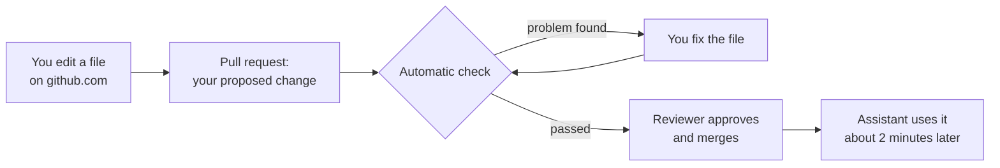

# How to edit the knowledge base

The sales assistant answers only from the files in this folder. You can change them here on github.com, with
no software to install. Every change is checked automatically and approved by a reviewer before the assistant
sees it.

Two words you will see:

- **Pull request**: your change, waiting for approval. Nothing reaches the assistant until it is merged.
- **Merge**: the reviewer accepts the pull request. That publishes it.

## Edit an existing case study

1. Open the repository on github.com, then the folder **knowledge → case-studies**.
2. Click the client's file. Files are named after the client in lowercase with hyphens, for example
   `brisbane-broncos.md`. Anonymous clients are named after their description, for example
   `a-real-estate-group-operating-in-australia.md`. Press `t` to search file names.
3. Click the **pencil icon** (Edit this file) at the top right of the file.
4. Make your change. Keep the block between the two `---` lines in the same shape (see
   [The fields at the top](#the-fields-at-the-top)).
5. Change the `updated:` line to today's date, for example `updated: 2026-11-25`.
6. Click **Commit changes…**. Write one line saying what you changed, choose **Create a new branch for this
   commit and start a pull request**, and click **Propose changes**.
7. On the next page, click **Create pull request**.

That's it. The check runs within a minute (see [If the check finds a problem](#if-the-check-finds-a-problem)),
then a reviewer gets the request.

## Add a new case study

1. Open **knowledge → case-studies → `_template.md`** and click the **copy icon** (Copy raw file) at the top
   right.
2. Go back to **case-studies** and click **Add file → Create new file**.
3. Name the file after the client in lowercase with hyphens, ending in `.md`, for example `acme-retail.md`.
   For an anonymous client, use the description instead of the name.
4. Paste the template and replace every value. The notes starting with `#` explain each field.
5. Write the case study under the second `---` line. **The first paragraph is the summary** the assistant reads
   first: two or three sentences on the problem, what Engaging built and the result.
6. Click **Commit changes…** and continue from step 6 above.

## The fields at the top

| Field            | What to write                                                                                   |
| ---------------- | ----------------------------------------------------------------------------------------------- |
| `client`         | The client's real name                                                                          |
| `display_name`   | What the assistant calls them: the same name, or a description if they must stay anonymous      |
| `status`         | How much the assistant may say (next table)                                                     |
| `url`            | The case study page on www.engaging.io, copied from the address bar. `null` if there is no page |
| `industry`       | A list in square brackets: `['Retail', 'Ecommerce']`                                            |
| `region`         | A list: `['AUS']`, `['AUS', 'NZ']`                                                              |
| `hubs`           | The HubSpot hubs and tiers: `['Marketing Hub Enterprise']`                                      |
| `migration_from` | Platforms they moved from: `['Salesforce']`, or `[]` for a fresh setup                          |
| `updated`        | The date you last checked the file, as year-month-day                                           |

Text with an apostrophe or a colon goes in double quotes: `display_name: "Australia's largest retailer"`.

## Status: how much the assistant may say

| Status           | Use it when                                          | What the assistant does                                             |
| ---------------- | ---------------------------------------------------- | ------------------------------------------------------------------- |
| `published`      | There is a public case study page                    | Names the client and links the page                                 |
| `reference`      | The client agreed to be named, but there is no page  | Names the client, no link                                           |
| `anonymous`      | The client asked not to be named                     | Uses only `display_name`; the real name never leaves GitHub         |
| `draft`          | Written up but not approved by the client            | Uses it, but results, numbers and quotes are removed first          |
| `excluded`       | Keep the record, but the assistant should not use it | Knows nothing about it                                              |
| `never_disclose` | The name must never appear anywhere                  | Knows nothing about it, and the check blocks the name in every file |

**A client asks to be anonymous:** change `status` to `anonymous`, set `display_name` to a description (for
example `An Australian real estate group`), and remove their name, brands, venues and event names from the
text. Add any other names they go by, one per line, to `never-disclose.txt`. The check then makes sure none of
them appears anywhere.

## If the check finds a problem

The pull request shows a red cross next to **Knowledge base**, and the problem appears on the file itself under
**Files changed**. **Details** opens a summary that says, in a table, which file and what is wrong.

1. Open the file named in the summary (from **Files changed**, click **⋯ → Edit file**).
2. Fix it and click **Commit changes…**, keeping **Commit directly to the** branch of this pull request.
3. The check runs again by itself. A green tick means it passed.

| The check says                             | What to do                                                                                   |
| ------------------------------------------ | -------------------------------------------------------------------------------------------- |
| contains "…", which must never be uploaded | Replace that name with a description. Check headings and the file name too                   |
| a 'published' case study needs a … url     | Paste the www.engaging.io page address into `url`, or change the status                      |
| invalid frontmatter / cannot read line     | A field at the top is misspelled or lost its quotes or brackets. Compare with `_template.md` |
| Google Docs escape left in the text        | Remove the stray backslashes (`\*`, `https\:`) left by copying from Google Docs              |
| slug "…" is also used by …                 | Another file has the same name. Rename yours                                                 |

A note about the size of the knowledge base ("tokens") does not block anything; the reviewer handles it.

## For the repository admin

- Give each editor the **Write** role (repository **Settings → Collaborators and teams**). They then edit on
  branches of this repository, without making copies of it.
- Protect `main` (**Settings → Rules → Rulesets → New branch ruleset**, target the default branch): require a
  pull request with 1 approval, and block force pushes. Editors then cannot change `main` without review.
- Make the reviewers explicit with a `.github/CODEOWNERS` line such as `/knowledge/ @<reviewer>` and tick
  **Require review from Code Owners** in the ruleset.
- Do not mark the **Knowledge base** check as required: it only runs when `knowledge/` changes, so a required
  check would hold up every other pull request. A reviewer simply does not merge while it is red.
- Automatic publishing on merge needs the repository variable `DEPLOY_ENABLED=true`
  (`.github/workflows/kb.yml`). Until it is set, a developer runs `./cli.sh kb-publish` after each merge.

The technical reference (how the files are built and published, rollbacks) is [README.md](README.md).
